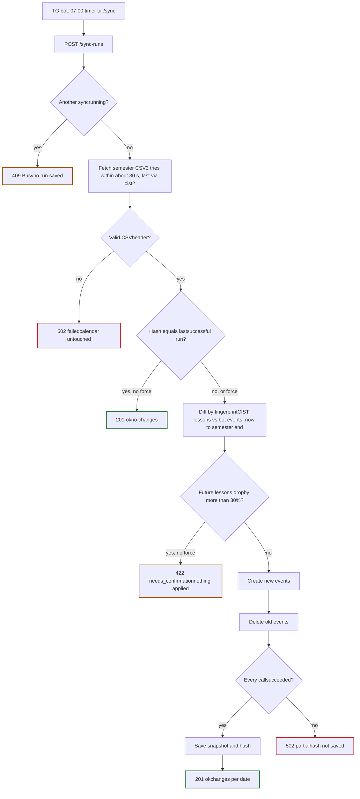

C++ course project · NURE · group 12387395

# CIST Sync Edge Cases

What cist-syncer and the Telegram bot do when a service is down, the timetable changes or something breaks, and whether the Google Calendar and Telegram parts are feasible in C++.

- **cist-syncer:** REST service, no timers
- **TG bot:** daily timer, commands, alerts
- **Calendar:** create and delete only, never edit
- **Source:** CIST CSV for the whole semester
- **Storage:** every run is saved

01

## Sync run

One `POST /sync-runs`, from request to response, with every failure path.



Every ending except 409 is saved as a run, so `/status`, `/report` and the bot's catch-up check always see it. Red outlines are failures the bot retries or alerts on, orange need you, green are normal endings.

### Rules the diagram depends on

- **Hash a fixed date range.**The CSV covers the whole semester (1 Sep–31 Jan or 1 Feb–30 Jun, worked out from today's date or set in env). A moving range like "today + 30 days" would change the hash every morning even when no lesson changed.
- **Save the hash only after every calendar call succeeds.**If it were saved first and a Google call then failed, the next run would see an equal hash, skip, and leave the calendar wrong.
- **Create first, delete second.**If the run stops halfway, you see a duplicate lesson for a few hours rather than a missing one. The next run removes the duplicate.
- **Guard on lesson count, not delete count.**With create and delete only, a building-wide room change deletes every event, which is normal. What is suspicious is the CSV suddenly having far fewer future lessons than the calendar, so that is what the guard checks.

02

## Lesson changes

Create and delete only. No event is ever edited.

Each lesson gets a **fingerprint**: a SHA-1 of its normalised date, start, end, discipline, type, room, teachers and groups. The bot stores it in the event's private extended properties as `source=cist-sync` and `fp=<hash>`.

The calendar diff is then two set differences: fingerprints in CIST but not in the calendar are **created**; fingerprints in the calendar but not in CIST are **deleted**. Any change to any field changes the fingerprint, so there is nothing to edit.

The message you get is built separately, by comparing the new CSV with the saved snapshot. A delete and a create at the same date and start time are shown as one line.

| What changed in CIST | Google Calendar | Shown in Telegram as |
| --- | --- | --- |
| New lesson | Create | added |
| Lesson cancelled | Delete | removed |
| Different discipline at the same time | Create new, then delete old | replaced Фізика → ООП |
| Room or teacher changed | Create new, then delete old | changed room 165-1 → 287 |
| Moved to another time or day | Create new, then delete old | removed + added |

Let Google generate event IDs instead of using the fingerprint as the ID. Google keeps deleted events for a while, so re-creating a lesson that was cancelled and later restored with the same ID can fail with `409 duplicate`.

### Response of `POST /sync-runs`

```
{
  "id": 57,
  "trigger": "schedule",
  "started_at": "2026-10-12T07:00:02+03:00",
  "finished_at": "2026-10-12T07:00:09+03:00",
  "status": "ok",
  "calendar": { "created": 2, "deleted": 2 },
  "changes": {
    "2026-10-14": [
      { "kind": "replaced", "start": "09:30",
        "from": { "subject": "Фізика", "type": "Лк", "room": "165-3" },
        "to":   { "subject": "ООП", "type": "Лб", "room": "287" } },
      { "kind": "changed", "start": "11:15",
        "subject": "Вища математика",
        "field": "room", "from": "165-1", "to": "287" }
    ]
  },
  "error": null
}
```

On failure, `error` is filled, for example `{"source": "cist", "retryable": true, "message": "timeout after 3 attempts"}`. The bot reads `retryable` to decide whether to try again.

### Message you receive

```
Schedule changes

Wed 14.10
↔ 09:30  Фізика (Лк) replaced by ООП (Лб), room 287
~ 11:15  Вища математика: room 165-1 → 287
```

Example data. Times, rooms and disciplines are illustrative.

03

## Edge cases

39 cases in five areas. "Response" is what `POST /sync-runs` returns; a dash means it does not affect the response.

| # | Case | What happens | Response | In Telegram |
| --- | --- | --- | --- | --- |
| CIST source 8 cases |  |  |  |  |
| 1 | CIST is down, times out or returns 5xx | Three tries within about 30 s, the last one via cist2.nure.ua. The calendar is not touched. | 502 failedretryable | Bot retries at 07:05, 07:10, 07:20, 07:40. One "sync is broken" alert after the last attempt. |
| 2 | Error or maintenance page with HTTP 200 | The header row check fails. Treated like CIST being down, never as an empty timetable. | 502 failedretryable | Same as case 1. |
| 3 | CIST changes the CSV columns | The header check fails with "unexpected CSV format". Retrying won't help; the parser has to be updated. | 502 failednot retryable | Alert right away with the reason. |
| 4 | Empty or cut-off CSV | The CSV has fewer than 70% of the future lessons the calendar has. Nothing is applied. | 422 needs_confirmation | "CIST shows 40% fewer lessons. Apply anyway? /sync force" |
| 5 | Text arrives in Windows-1251 | Converted to UTF-8 before parsing and hashing, otherwise messages show broken Cyrillic. | — | — |
| 6 | Same timetable, rows reordered or spacing changed | The hash is taken over normalised, sorted lessons, not the raw file, so this is not a change. | 201 ok, no changes | No message |
| 7 | Export link carries a login session ID | The URL is built from the group ID and semester dates only and must work without logging in. | — | — |
| 8 | Semester boundary | The range switches on 1 Feb and 1 Sep. Before a new timetable is published, the CSV and the calendar both have no future lessons, so nothing happens. | 201 ok, no changes | No message |
| Lesson changes, create and delete only 11 cases |  |  |  |  |
| 9 | First run, empty calendar | Creates every future lesson of the semester. | 201 ok | One line: "Imported 312 lessons." |
| 10 | New lesson | Create. | 201 ok | Listed under its date as added. |
| 11 | Lesson cancelled | Delete. Only future lessons are deleted. | 201 ok | Listed as removed. |
| 12 | Different discipline at the same time | Create the new event, then delete the old one. | 201 ok | One line: "Фізика replaced by ООП". |
| 13 | Room, teacher or time changed | The fingerprint changes, so create new, then delete old. No edit. | 201 ok | "room 165-1 → 287". A move to another day shows as removed + added. |
| 14 | Two lessons in one slot (subgroups, two rooms) | Room and groups are part of the fingerprint, so both events exist side by side. | — | Normal entries |
| 15 | Lesson in the past or already started | Only events starting after the current time are created or deleted. History stays as it was. | — | — |
| 16 | Your own events in the same calendar | Only events tagged `source=cist-sync` are listed and deleted. A dedicated calendar is still safer. | — | — |
| 17 | You delete or move a bot event by hand | The CIST hash hasn't changed, so the run skips. The event comes back with the next CIST change or `/sync force`, which ignores the hash. | 201 ok, no changes | No message |
| 18 | Two calendar events with the same fingerprint | Happens when an insert succeeded but its response was lost and it was retried. Keep one, delete the rest. | 201 ok | No message |
| 19 | Clocks go back on 25 Oct 2026 | Events are sent with `timeZone: Europe/Kyiv` and local times. Both containers set `TZ=Europe/Kyiv` and install `tzdata`. | — | — |
| Google Calendar 6 cases |  |  |  |  |
| 20 | 401 invalid credentials | The one-hour access token expired. Sign a new JWT, get a new token, retry the call once. | — | — |
| 21 | 403 rate limit, 429, 500 or 503 | Exponential backoff with jitter, up to five attempts per call, then the run stops. | 502 partialretryable | Bot retries on its schedule. |
| 22 | 403 forbidden or 404 on the calendar | The calendar isn't shared with the service account or the calendar ID is wrong. | 502 failednot retryable | Alert right away: "Share the calendar with the service account." |
| 23 | Some calls failed in the middle of a run | The hash is not saved. The next run compares with the calendar again and only does what is still missing. | 502 partialretryable | Bot retries on its schedule. |
| 24 | Delete returns 404 or 410 | The event is already gone. Counted as a success. | — | — |
| 25 | More events than fit in one list response | Follow `nextPageToken` until it is empty before computing the diff. | — | — |
| cist-syncer service 5 cases |  |  |  |  |
| 26 | Second sync while one is running | A mutex allows one sync at a time. The second caller is rejected. | 409 Busy | "Sync already running", then the result of that run. |
| 27 | Container stops in the middle of a sync | On start, runs still marked `running` are set to `failed: interrupted`. The hash was not saved, so the next run finishes the job. | — | Next scheduled run repairs it |
| 28 | Data volume lost | No snapshot or hash. The next run rebuilds them; the calendar diff stops it from creating duplicates. | 201 ok | One line: "Baseline rebuilt." |
| 29 | Bug or unexpected exception | The run is saved as failed with the exception message. | 500 | Alert right away. Retrying won't fix a bug. |
| 30 | Secrets | The Google key is mounted as a file. It never goes into the image or Git. | — | — |
| Telegram bot 9 cases |  |  |  |  |
| 31 | Bot was off at 07:00 | On start it calls `GET /sync-runs/latest`. If daily sync is on and the last run is older than 24 h, it syncs now. | — | Normal result |
| 32 | cist-syncer unreachable | Connection refused or no answer counts as a failed attempt. | no response | Retries on schedule, then one alert. |
| 33 | Bot loses the response (2-min timeout, restart) | The run is still saved. The bot reads `GET /sync-runs/latest` and handles that run. | — | Normal result |
| 34 | Message from another chat | Ignored. Only the owner chat ID from env is served. | — | No reply |
| 35 | Invalid `/schedule` time, such as 25:00 | Setting unchanged. A valid new time replaces the old one. | — | "Use /schedule HH:MM, for example /schedule 07:00." |
| 36 | settings.json missing or corrupt | Start with daily sync off. The file is always written to a temp file and renamed, so a crash can't half-write it. | — | "Daily sync is off. Turn it on with /schedule 07:00." |
| 37 | Long report, such as a whole week rescheduled | Split by date into messages under 4096 characters, at most one per second. | — | Several messages |
| 38 | Telegram returns 429 or is unreachable | Wait `retry_after` or back off, then resend. The run is saved in cist-syncer either way. | — | Delayed; `/report` also shows it |
| 39 | Sync failing for several days | The bot keeps an "alert open" flag in settings.json and doesn't repeat the alert. | — | One "sync is broken" message, then one "back to normal". |

04

## Bot reactions

How the bot handles each response from `POST /sync-runs`.

| Response | Retry? | Bot does |
| --- | --- | --- |
| 201 | No | Sends a message only if `changes` is not empty. Closes an open alert with "back to normal". |
| 502retryable | Yes | Tries again at 07:05, 07:10, 07:20, 07:40. One alert after the last attempt fails. |
| 502not retryable | No | Alerts right away with the error message. |
| no response | Yes | Same as retryable 502. After a timeout, first checks `/sync-runs/latest` in case the run finished. |
| 409 | No | Waits a minute, then shows the result from `/sync-runs/latest`. |
| 422 | No | Asks you to confirm. `/sync force` sends `{"force": true}`. |
| 500 | No | Alerts right away. |

The bot's HTTP timeout (about 2 minutes) must be longer than the slowest possible sync. cist-syncer keeps its own retries short so a sync always fits inside one request.

05

## Feasibility

The two checks your lecturer asked for.

Feasible

### Google Calendar from cist-syncer

A service account is a robot Google account with its own key file. It needs no browser login and no one present, which suits a container called by a timer at 07:00.

#### What you need

- A Google Cloud project on your personal account, with the Google Calendar API enabled
- A service account and its JSON key, mounted into the container
- A calendar you create, shared with the service account's email with "Make changes to events"
- That calendar's ID in env, and the scope `calendar.events`

#### How it works in C++

- Sign a JWT with the key (RS256 via OpenSSL or jwt-cpp), exchange it for a one-hour access token, cache it
- Only three calls: `events.list`, `events.insert`, `events.delete`, over HTTPS with cpr or libcurl
- No 7-day token expiry: that limit applies to OAuth apps in testing mode, not to service accounts
- Free to use. A few hundred events per semester is far below the rate limits

**Effort:** about one week, most of it JWT signing and error handling.

Feasible

### Telegram bot in C++

The bot receives commands through long polling, so nothing has to be reachable from the internet. Sending a message is one call to `sendMessage`.

#### What you need

- A bot token from @BotFather
- Your chat ID: send `/start` to the bot, then read it once from `getUpdates`
- You message the bot first. A bot cannot start a chat with a user

#### How it works in C++

- **tgbot-cpp** handles commands and long polling. It is available through vcpkg and as a Docker base image, and it pulls in Boost
- The daily timer is a thread that sleeps with `condition_variable::wait_until` until the next run; `/schedule` and `/unschedule` wake it to recalculate
- Calls to cist-syncer use cpr or libcurl with nlohmann/json, the same libraries as the service

**Effort:** about one week for the commands, the timer, the retry schedule and message splitting.

Dropping the MCP server saves about a week, and the bot's commands and timer take about a week, so the plan stays at roughly 8–9 weeks.

—

## Sources

- [Google Calendar API: Handle API errors](https://developers.google.com/workspace/calendar/api/guides/errors)
- [Google: refresh tokens in Testing vs In production](https://developers.google.com/health/setup)
- [Calendar events through a service account (DEV Community)](https://dev.to/pedrohase/create-google-calender-events-using-the-google-api-and-service-accounts-in-nodejs-22m8)
- [Telegram Bots FAQ: sending limits](https://core.telegram.org/bots/faq)
- [tgbot-cpp on GitHub](https://github.com/reo7sp/tgbot-cpp)
- [Nure.NET: CIST mirror cist2.nure.ua and malformed responses](https://www.nuget.org/packages/nure.net)
- [Sud.ua: winter time switch on 25 October 2026](https://sud.ua/en/news/ukraine/368237-zymovyi-chas-2026-koly-perevodyty-hodynnyky-ta-chy-bude-perekhid-tsiiei-oseni)